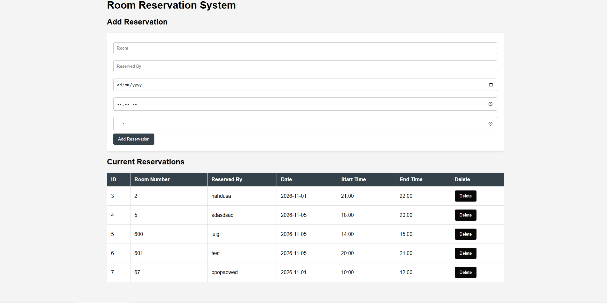

# Room Reservation System

# OVERVIEW
In compliance with our Integrative Programming Midterm Exam, this Room Resrvation System allows the user to View the room reservations, Add a new reservation, Delete a reservation and also has a conflict checker to deny any duplicate reservations for a room on a specific day.

